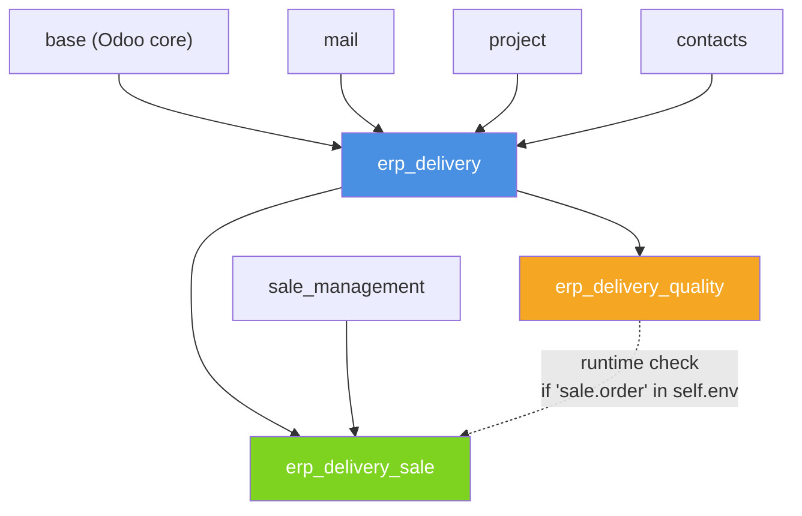
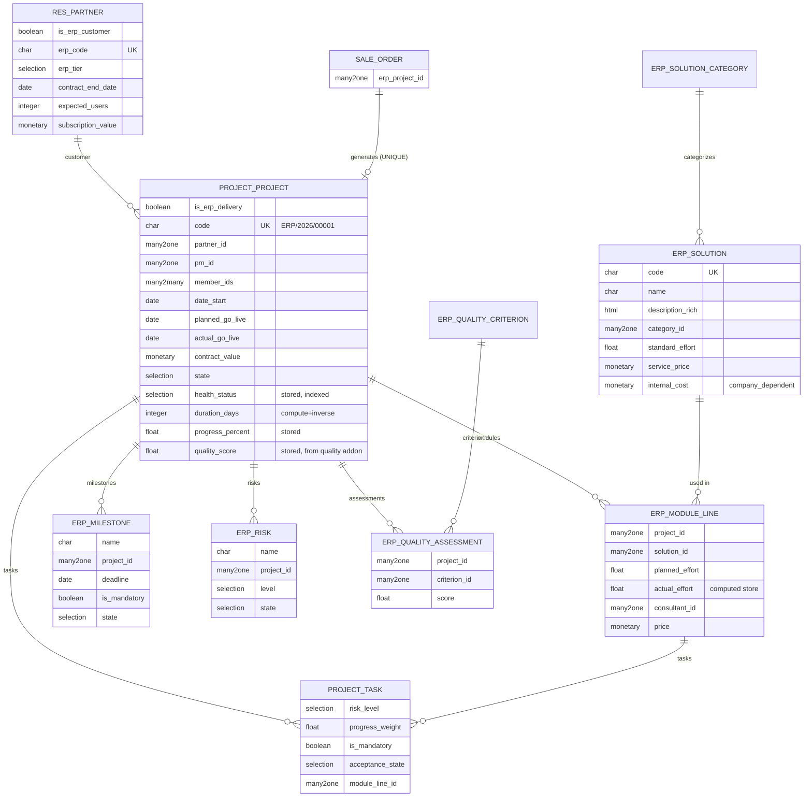
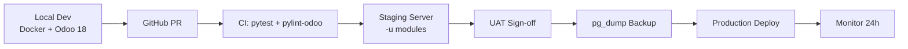

# KẾ HOẠCH THỰC THI DỰ ÁN
## ERP Platform Delivery Management — Odoo 18 Backend

**Tài liệu chuẩn bị bởi:** Technical Architect
**Đối tượng:** Đội ngũ Dev nội bộ + Ban giám đốc
**Nền tảng:** Odoo 18 Community · Python 3.10+ · PostgreSQL 14+
**Phạm vi:** 3 custom addons, Backend-only (không JS/OWL/frontend tùy chỉnh)
**Thời lượng:** 5 sprints × 2 tuần = 10 tuần
**Tổng điểm mục tiêu:** 100/100

---

## MỤC LỤC

1. [Phân tích & Mô-đun hóa Hệ thống](#1-phân-tích--mô-đun-hóa-hệ-thống)
2. [Thiết kế Kiến trúc Dữ liệu Cốt lõi](#2-thiết-kế-kiến-trúc-dữ-liệu-cốt-lõi)
3. [Lộ trình Thực thi theo Giai đoạn](#3-lộ-trình-thực-thi-theo-giai-đoạn)
4. [Chiến lược Kiểm thử & Deploy](#4-chiến-lược-kiểm-thử--deploy)
5. [Quản trị Rủi ro & Best Practices](#5-quản-trị-rủi-ro--best-practices)
6. [Phụ lục](#6-phụ-lục)

---

# 1. PHÂN TÍCH & MÔ-ĐUN HÓA HỆ THỐNG

## 1.1. Bối cảnh nghiệp vụ

Xây dựng bộ addon Odoo 18 quản lý toàn bộ vòng đời triển khai ERP:
- Khách hàng ERP (khác contact thông thường)
- Danh mục giải pháp/phân hệ ERP (Sales, CRM, HR, v.v.)
- Dự án triển khai (state machine, PM, team, dates, contract value)
- Phân hệ triển khai theo dự án + tasks + milestones + risks
- Tích hợp Sales (tạo project từ Sale Order)
- Quality Gate tùy chọn (chấm điểm chất lượng, chặn Go-live)
- Multi-company, phân quyền 3 vai trò, khả năng scale 500k+ records

## 1.2. Quyết định kiến trúc: **3 addons** thay vì 2

Đề cho phép 2–3 addon. Bảng so sánh:

| Phương án | Ưu điểm | Nhược điểm | Kết luận |
|---|---|---|---|
| **2 addons** (core + all-optional) | Ít file, đơn giản manifest | Không tách được Sales và Quality Gate cài độc lập → mất điểm Phần 1, 6, 7 (yêu cầu "khả năng cài độc lập") | ❌ Loại |
| **3 addons** (core + sale + quality) | Đúng tinh thần "cài độc lập từng gói" của Phần 1 & 7; mỗi addon một concern rõ ràng | Phải xử lý bridge case (cả 2 optional cùng cài) bằng runtime check | ✅ **Chọn** |
| **4 addons** (core + sale + quality + bridge) | Chuẩn Odoo enterprise pattern (bridge `auto_install=True`) | **Vi phạm ràng buộc "tối đa 3"** | ❌ Loại |

### Hệ quả kỹ thuật quan trọng

Vì không có bridge module riêng, phần logic "Sales + Quality cùng cài" **BẮT BUỘC** xử lý runtime bên trong `erp_delivery_quality` bằng cách kiểm tra:

```python
if 'sale.order' in self.env:
    # Extra commercial validation
    ...
```

Cách này an toàn vì `self.env` chỉ chứa model đã đăng ký trong registry — nếu `erp_delivery_sale` chưa cài thì `sale.order` không có mặt.

## 1.3. Danh sách addon

| Addon | Vai trò | Bắt buộc? | Depend chính |
|---|---|---|---|
| `erp_delivery` | **CORE**: Customer, Solution catalog, Project, Module lines, Task, Milestone, Risk, Sequence, Security groups, Go-live base workflow | ✅ Bắt buộc | `base`, `mail`, `project`, `contacts` |
| `erp_delivery_sale` | Sales Integration: tạo Project từ Sale Order, đồng bộ khách hàng & giá trị hợp đồng, smart button navigation 2 chiều | ⚪ Tùy chọn | `erp_delivery`, `sale_management` |
| `erp_delivery_quality` | Quality Gate: Quality Score, chặn Go-live nếu chưa đạt ngưỡng, thêm check thương mại nếu Sales có mặt (runtime check) | ⚪ Tùy chọn | `erp_delivery` **(KHÔNG depend sale)** |

## 1.4. Sơ đồ Dependency Graph



### Diễn giải quan hệ

- **Đường nét liền**: dependency cứng khai báo trong `__manifest__.py`.
- **Đường nét đứt**: dependency mềm (runtime detection), KHÔNG khai báo trong manifest.
- `erp_delivery` **KHÔNG** depend `sale_management` → thỏa yêu cầu Phần 6: *"Phần lõi quản lý delivery không được phụ thuộc không cần thiết vào chức năng Sales"*.
- `erp_delivery_quality` **KHÔNG** depend `erp_delivery_sale` → thỏa yêu cầu Phần 7: *"Quality Gate phải có thể cài và hoạt động ngay cả khi không cài Sales Integration"*.

## 1.5. Vì sao inherit `project.project` thay vì tạo model mới hoàn toàn

Đây là quyết định kiến trúc quan trọng nhất của core module.

| Approach | Trade-off | Điểm |
|---|---|---|
| **`_inherit = 'project.project'`** (chọn) | ✅ Tận dụng chatter, activities, Kanban, timesheet có sẵn của module `project`; ✅ Reviewer thấy delivery data trong Project chuẩn — đề gợi ý ở Phần 5: *"thông tin delivery xuất hiện hợp lý trong Project/Task nếu thí sinh tận dụng đối tượng chuẩn"* — đây là **hint chấm điểm**; ⚠️ Cần cẩn thận với default rules và fields của module `project` (VD: `stage_id`, `partner_id` đã có) | +2đ ước tính |
| Tạo `erp.project` mới hoàn toàn | ✅ Full control, không phụ thuộc `project` module; ❌ Phải tự viết lại chatter, activity, Kanban → tốn effort mà không thêm điểm | -2đ |
| Delegation inheritance (`_inherits = {'project.project': 'project_id'}`) | ⚠️ Copy field xuống record con nhưng khó extend method, dễ vỡ khi upgrade Odoo; hiếm dùng cho case business logic phức tạp | -3đ |

**Kết luận:** `_inherit = 'project.project'` (classical inheritance) + thêm field `is_erp_delivery` (boolean, indexed) để phân biệt project ERP với project thường trong hệ thống.

## 1.6. Vì sao inherit `project.task` cho Task

Cùng lý do như 1.5: đề gợi ý tận dụng object chuẩn. Task chuẩn của Odoo đã có: state, kanban stage, assignee, deadline, chatter, timesheet. Ta chỉ cần thêm field:
- `risk_level` (Selection)
- `progress_weight` (Float)
- `is_mandatory` (Boolean)
- `acceptance_state` (Selection: draft/pending/accepted/rejected)
- `module_line_id` (Many2one → `erp.project.module.line`)

---

# 2. THIẾT KẾ KIẾN TRÚC DỮ LIỆU CỐT LÕI

## 2.1. Bảng model chi tiết

### 2.1.1. Addon `erp_delivery` (Core)

| Model | Kỹ thuật | Fields chính | Ghi chú |
|---|---|---|---|
| `res.partner` | `_inherit` | `is_erp_customer` (Bool, indexed), `erp_code` (Char, indexed, company-unique), `erp_tier` (Selection: bronze/silver/gold/platinum), `contract_end_date` (Date), `expected_users` (Int), `subscription_value` (Monetary), `erp_project_ids` (One2many ngược) | **Phần 2** — KHÔNG tạo model contact song song. Tận dụng `res.partner` chuẩn của Odoo. |
| `erp.solution.category` | Mới | `name`, `code`, `sequence` | Master data trong `data/` |
| `erp.solution` | Mới, `_inherit = ['mail.thread']` | `code`, `name`, `description_short`, `description_rich` (Html), `category_id` (M2o), `active` (Bool), `standard_effort` (Float), `service_price` (Monetary), `internal_cost` (Monetary, `company_dependent=True`), `image` (Binary), `document_ids` (M2m attachment) | **Phần 3** — `internal_cost` dùng `company_dependent=True` để khác nhau giữa các company |
| `project.project` | `_inherit`, `_inherit = ['mail.thread', 'mail.activity.mixin']` (đã có sẵn) | `is_erp_delivery` (Bool, indexed), `code` (Char, indexed, sequence-generated), `pm_id` (M2o `res.users`, tracking), `member_ids` (M2m `res.users`), `date_start` (Date), `planned_go_live` (Date, tracking), `actual_go_live` (Date, readonly), `contract_value` (Monetary, tracking), `state` (Selection, tracking), `note_internal` (Text, groups=manager) và các computed fields (xem 2.3) | **Phần 4 + 5** — model trung tâm |
| `erp.project.module.line` | Mới | `project_id` (M2o), `solution_id` (M2o), `planned_effort` (Float), `actual_effort` (Float, computed store), `consultant_id` (M2o `res.users`), `price` (Monetary), `state` (Selection), `note` (Text), `task_ids` (O2m) | **Phần 5** — bảng trung gian project ↔ solution. **KHÔNG dùng M2M thuần** vì cần lưu effort/consultant/price riêng cho từng cặp. SQL constraint UNIQUE(project_id, solution_id). |
| `project.task` | `_inherit` | `risk_level` (Selection: low/medium/high/critical), `progress_weight` (Float, default=1.0), `is_mandatory` (Bool), `acceptance_state` (Selection), `module_line_id` (M2o `erp.project.module.line`) | **Phần 5** — tận dụng task chuẩn |
| `erp.milestone` | Mới, `_inherit = ['mail.thread']` | `name`, `project_id` (M2o), `deadline` (Date), `is_mandatory` (Bool), `state` (Selection: pending/done/blocked), `note` | **Phần 5** |
| `erp.risk` | Mới, `_inherit = ['mail.thread']` | `name`, `project_id` (M2o), `level` (Selection: low/medium/high/critical), `state` (Selection: open/mitigated/closed), `owner_id` (M2o `res.users`), `mitigation_plan` (Text) | **Phần 7** — blocker Go-live |

### 2.1.2. Addon `erp_delivery_sale`

| Model | Kỹ thuật | Fields chính | Ghi chú |
|---|---|---|---|
| `sale.order` | `_inherit` | `erp_project_id` (M2o `project.project`, readonly), `is_erp_ready` (Bool, computed — điều kiện tạo project) | Smart button "View ERP Project" |
| `project.project` | `_inherit` | `sale_order_id` (M2o `sale.order`, readonly, SQL constraint UNIQUE) | Smart button ngược "View Source SO" |

**Action chính:** `sale.order.action_create_erp_project()` — tạo project với data từ SO (partner_id, amount_total → contract_value, order line → gợi ý module_line).

### 2.1.3. Addon `erp_delivery_quality`

| Model | Kỹ thuật | Fields chính | Ghi chú |
|---|---|---|---|
| `erp.quality.criterion` | Mới | `name`, `code`, `weight` (Float), `category` (Selection: task/milestone/risk/commercial), `active` (Bool) | Master data trong `data/` |
| `erp.quality.assessment` | Mới, `_inherit = ['mail.thread']` | `project_id` (M2o), `criterion_id` (M2o), `score` (Float 0–10), `note`, `assessed_by` (M2o), `assessed_date` (Datetime) | Bản đánh giá từng tiêu chí cho từng project |
| `project.project` | `_inherit` | `quality_score` (Float, computed store — weighted avg), `quality_threshold` (Float, default 7.0, config-per-company), `quality_assessment_ids` (O2m), `is_quality_gate_passed` (Bool, computed) | Override `_check_go_live_conditions()` để bổ sung Quality check + Commercial check nếu Sales cùng cài |

## 2.2. Sơ đồ ERD tổng thể



## 2.3. Computed Fields — Bảng chi tiết

Đây là phần technical nhất của bài, tập trung nhiều điểm (Phần 5 + Phần 9).

| Field | Model | Compute logic | Store? | Depends | Index? | Ghi chú |
|---|---|---|---|---|---|---|
| `module_count` | project | `len(module_line_ids)` | ✅ | `module_line_ids` | ❌ | Dùng ở list view |
| `total_planned_effort` | project | `sum(module_line_ids.planned_effort)` | ✅ | `module_line_ids.planned_effort` | ❌ | |
| `total_actual_effort` | project | `sum(module_line_ids.actual_effort)` | ✅ | `module_line_ids.actual_effort` | ❌ | |
| `actual_effort` | module_line | `sum(task_ids.effective_hours)` | ✅ | `task_ids.effective_hours` | ❌ | |
| `mandatory_task_count` | project | Count task có `is_mandatory=True` | ✅ | `task_ids.is_mandatory` | ❌ | |
| `mandatory_done_count` | project | Count task `is_mandatory=True AND stage_id.is_closed` | ✅ | `task_ids.is_mandatory, task_ids.stage_id` | ❌ | |
| `progress_percent` | project | Weighted avg: `sum(task.progress * task.progress_weight) / sum(task.progress_weight)` | ✅ | `task_ids.progress_weight, task_ids.stage_id` | ❌ | |
| `customer_code` | project | `related='partner_id.erp_code'` | ✅ | (auto) | ✅ | **Phần 5** yêu cầu — related store để search nhanh |
| `duration_days` | project | `(planned_go_live - date_start).days` | ✅ | `planned_go_live, date_start` | ❌ | **Có `inverse` method** — xem 2.4 |
| `health_status` | project | Selection [green, amber, red] tính từ progress, overdue tasks, open critical risks, go-live proximity | ✅ | `progress_percent, task_ids.date_deadline, risk_ids.level, planned_go_live` | ✅ **BẮT BUỘC** | **Phần 5** yêu cầu filter theo health |
| `quality_score` | project (quality addon) | Weighted avg từ `quality_assessment_ids` | ✅ | `quality_assessment_ids.score, quality_assessment_ids.criterion_id.weight` | ❌ | |

### 2.3.1. Vì sao `health_status` phải store + index

Đề Phần 5 nói rõ: *"Người dùng phải tìm kiếm/lọc được dự án theo tình trạng sức khỏe."*

Trade-off:

| Approach | Ưu | Nhược |
|---|---|---|
| **Stored + indexed** (chọn) | Search cực nhanh, group_by hoạt động, filter chuẩn | Tốn storage (~50 bytes/record × 100k = 5MB — không đáng kể); phải recompute |
| Non-stored + `search=` method | Không tốn storage | `search=` method chạy Python → chậm với 100k record, group_by không dùng được |
| Non-stored, không có search | Đơn giản nhất | ❌ Không đáp ứng yêu cầu đề |

### 2.3.2. Cron job cho `health_status`

Dù stored, `health_status` phụ thuộc `datetime.now()` (VD: task overdue = `date_deadline < today`). Không có trigger tự nhiên khi ngày trôi qua → cần cron job daily recompute:

```xml
<record id="cron_recompute_health" model="ir.cron">
    <field name="name">ERP: Recompute Project Health</field>
    <field name="model_id" ref="model_project_project"/>
    <field name="state">code</field>
    <field name="code">model._cron_recompute_health()</field>
    <field name="interval_number">1</field>
    <field name="interval_type">days</field>
</record>
```

Trong Python:
```python
@api.model
def _cron_recompute_health(self):
    active_projects = self.search([
        ('is_erp_delivery', '=', True),
        ('state', 'not in', ['done', 'cancel'])
    ])
    active_projects.invalidate_recordset(['health_status'])
    active_projects.modified(['health_status'])  # Trigger recompute
```

## 2.4. Pattern computed + inverse cho `duration_days`

Đề Phần 5 yêu cầu: *"user có thể nhập trực tiếp thời lượng triển khai và hệ thống phải điều chỉnh ngày kế hoạch tương ứng."*

Đây là pattern kinh điển **computed field với inverse method**:

```python
duration_days = fields.Integer(
    string="Duration (days)",
    compute='_compute_duration_days',
    inverse='_inverse_duration_days',
    store=True,
)

@api.depends('date_start', 'planned_go_live')
def _compute_duration_days(self):
    for rec in self:
        if rec.date_start and rec.planned_go_live:
            rec.duration_days = (rec.planned_go_live - rec.date_start).days
        else:
            rec.duration_days = 0

def _inverse_duration_days(self):
    for rec in self:
        if rec.date_start and rec.duration_days:
            rec.planned_go_live = rec.date_start + timedelta(days=rec.duration_days)
```

**Cẩn thận:** khi user nhập `duration_days`, inverse chạy → `planned_go_live` thay đổi → trigger recompute `duration_days` lại. Odoo xử lý recursion an toàn nhưng cần đảm bảo idempotent (nhập 90 → out ra 90, không phải 89 hay 91 do rounding).

## 2.5. Cấu hình phụ trợ

### 2.5.1. Sequence

```xml
<!-- data/ir_sequence_data.xml -->
<record id="seq_erp_project" model="ir.sequence">
    <field name="name">ERP Project Code</field>
    <field name="code">erp.project.code</field>
    <field name="prefix">ERP/%(year)s/</field>
    <field name="padding">5</field>
    <field name="company_id" eval="False"/>
    <field name="use_date_range">True</field>
</record>
```

Trong Python:
```python
@api.model_create_multi
def create(self, vals_list):
    for vals in vals_list:
        if vals.get('is_erp_delivery') and not vals.get('code'):
            vals['code'] = self.env['ir.sequence'].next_by_code('erp.project.code')
    return super().create(vals_list)
```

**Lưu ý:** `@api.model_create_multi` là bắt buộc từ Odoo 15+ (không dùng `@api.model` cho create). Điều này đảm bảo batch create không phá logic sequence.

### 2.5.2. Security Groups (`security/erp_delivery_security.xml`)

```xml
<record id="module_category_erp_delivery" model="ir.module.category">
    <field name="name">ERP Delivery</field>
    <field name="sequence">20</field>
</record>

<record id="group_erp_delivery_user" model="res.groups">
    <field name="name">User</field>
    <field name="category_id" ref="module_category_erp_delivery"/>
</record>

<record id="group_erp_delivery_consultant" model="res.groups">
    <field name="name">Consultant</field>
    <field name="category_id" ref="module_category_erp_delivery"/>
    <field name="implied_ids" eval="[(4, ref('group_erp_delivery_user'))]"/>
</record>

<record id="group_erp_delivery_manager" model="res.groups">
    <field name="name">Manager</field>
    <field name="category_id" ref="module_category_erp_delivery"/>
    <field name="implied_ids" eval="[(4, ref('group_erp_delivery_consultant'))]"/>
</record>
```

**`implied_ids`** = quan trọng: Manager tự động là Consultant tự động là User. Khi user thuộc nhiều group qua nhiều đường khác nhau, Odoo tự OR các quyền — đây là cách xử lý câu hỏi giải trình #6 của đề.

### 2.5.3. Record Rules — Multi-company isolation

```xml
<!-- Consultant chỉ thấy project mình là PM hoặc member -->
<record id="rule_project_consultant" model="ir.rule">
    <field name="name">ERP Project: Consultant sees own projects</field>
    <field name="model_id" ref="project.model_project_project"/>
    <field name="groups" eval="[(4, ref('group_erp_delivery_consultant'))]"/>
    <field name="domain_force">
        ['|', ('pm_id', '=', user.id), ('member_ids', 'in', [user.id])]
    </field>
    <field name="perm_read">True</field>
    <field name="perm_write">True</field>
    <field name="perm_create">False</field>
    <field name="perm_unlink">False</field>
</record>

<!-- Manager thấy hết trong company được phép -->
<record id="rule_project_manager_multi_company" model="ir.rule">
    <field name="name">ERP Project: Multi-company for Manager</field>
    <field name="model_id" ref="project.model_project_project"/>
    <field name="groups" eval="[(4, ref('group_erp_delivery_manager'))]"/>
    <field name="domain_force">
        [('company_id', 'in', company_ids)]
    </field>
</record>
```

**Điểm mấu chốt:** dùng `company_ids` (list các company user được phép), **KHÔNG** dùng `company_id` (company hiện tại). Đây là bẫy phổ biến gây rò dữ liệu multi-company.

### 2.5.4. Master data vs Demo data

| Thư mục | Nội dung | Cài khi nào |
|---|---|---|
| `data/ir_sequence_data.xml` | Sequence project code | Cài mọi lúc |
| `data/erp_security_data.xml` | Groups, category, implied_ids | Cài mọi lúc |
| `data/solution_category_data.xml` | 4 categories chuẩn: Sales, Ops, Finance, HR | Cài mọi lúc |
| `data/mail_template_data.xml` | Email templates (Go-live notification, etc.) | Cài mọi lúc |
| `data/quality_criterion_data.xml` (quality addon) | Tiêu chí chất lượng chuẩn | Cài mọi lúc |
| `demo/res_company_demo.xml` | 2 companies test | Chỉ `--load-demo` |
| `demo/erp_customer_demo.xml` | 3 ERP customers | Chỉ dev/test |
| `demo/erp_project_demo.xml` | 3 projects, 6 module lines, 10 tasks, 2 milestones | Chỉ dev/test |
| `demo/res_users_demo.xml` | 3 users (User/Consultant/Manager) | Chỉ dev/test |

**Nguyên tắc:**
- `data/` KHÔNG được reference `demo/` (sẽ vỡ khi cài production).
- `noupdate="0"` mặc định cho data cần cập nhật khi upgrade module; `noupdate="1"` cho data user có thể chỉnh sửa (VD: templates).

---

# 3. LỘ TRÌNH THỰC THI (SPRINT PLAN)

**Tổng: 5 sprint × 2 tuần = 10 tuần.** Ưu tiên xây core vững trước, optional cuối. Mỗi sprint kết thúc bằng một Milestone review với DoD rõ ràng.

## Sprint 1 (Tuần 1–2): Foundation & Data Model

**Mục tiêu:** Có addon `erp_delivery` cài được, ERP Customer và Solution catalog hoạt động, phân quyền cơ bản OK.

### Backend
- Init addon `erp_delivery` với cấu trúc chuẩn:
  ```
  erp_delivery/
  ├── __init__.py
  ├── __manifest__.py
  ├── models/
  │   ├── __init__.py
  │   ├── res_partner.py
  │   ├── erp_solution.py
  │   └── erp_solution_category.py
  ├── views/
  │   ├── res_partner_views.xml
  │   ├── erp_solution_views.xml
  │   └── erp_delivery_menus.xml
  ├── security/
  │   ├── erp_delivery_security.xml
  │   └── ir.model.access.csv
  ├── data/
  │   ├── ir_sequence_data.xml
  │   └── solution_category_data.xml
  ├── demo/
  │   └── (later)
  └── tests/
      ├── __init__.py
      └── test_customer_and_solution.py
  ```
- `res.partner` inherit: `is_erp_customer`, `erp_code`, `erp_tier`, `contract_end_date`, `expected_users`, `subscription_value`, `erp_project_ids`.
- SQL constraint `UNIQUE(erp_code, company_id)` — company-scoped uniqueness.
- `erp.solution.category` (Master data).
- `erp.solution` với `internal_cost` là `company_dependent=True`.
- Security groups + record rules cơ bản.

### Frontend / UI
- Tab "ERP Info" trong form `res.partner`, visible khi `is_erp_customer=True`, editable khi có quyền.
- Filter mới: "ERP Customers" trong search view partner.
- Tree/form/kanban/search cho `erp.solution`.
- Menu: **ERP Delivery → Configuration → Solutions / Solution Categories**.

### Security & Phân quyền
- `ir.model.access.csv` cho `erp.solution` và `erp.solution.category` với 3 groups.
- Field `internal_cost` có `groups="erp_delivery.group_erp_delivery_manager"` → consultant/user không thấy.
- Field `subscription_value` trên partner: `groups="erp_delivery.group_erp_delivery_manager"`.

### Testing
- Unit test 1: Tạo ERP customer với `erp_code` duplicate → raise `IntegrityError`.
- Unit test 2: Consultant `.read()` solution → không có `internal_cost` trong result.
- Unit test 3: Đổi company qua `.with_company(company_b)` → `internal_cost` trả về giá khác.

### 🎯 Milestone 1 — Definition of Done

- [ ] Addon `erp_delivery` install/uninstall clean, không lỗi log.
- [ ] 3 unit test trên pass.
- [ ] Manual test qua UI: tạo ERP customer, tạo solution, đổi company thấy internal_cost đổi.
- [ ] README v0.1 có sơ đồ dependency và mô tả 3 addons dự kiến.
- [ ] Code review: 0 warning từ `pylint-odoo`.

---

## Sprint 2 (Tuần 3–4): Project Core & Workflow

**Mục tiêu:** Có `project.project` extended với ERP workflow, state machine hoạt động, tracking đầy đủ, phân quyền project OK.

### Backend
- Inherit `project.project` — thêm 15+ field như đã liệt kê ở 2.1.1.
- State machine với 8 state: `draft → analysis → implementation → uat → ready → go_live → done`, và `cancel` (từ mọi state trừ `done`).
- Sequence integration: override `create()` để auto-gen `code`.
- `@api.constrains`:
  - `planned_go_live >= date_start`
  - `actual_go_live` chỉ set khi state = `go_live` hoặc `done`
  - `contract_value >= 0`
- Chatter tracking: `tracking=True` trên `pm_id`, `planned_go_live`, `state`, `contract_value`, `partner_id`.
- Action methods: `action_start_analysis()`, `action_start_implementation()`, `action_start_uat()`, `action_ready_go_live()`, `action_go_live()`, `action_done()`, `action_cancel()`, `action_reset_to_draft()` (chỉ manager).

### Frontend / UI
- Form view với `<header>` chứa statusbar và buttons theo state.
- Tree view với các cột: code, name, partner_id, pm_id, state, planned_go_live, contract_value.
- Kanban view group theo state, color-coded.
- Search view với filter: My Projects (PM = self), My Team Projects (member_ids), theo state, theo PM, theo customer, date range Go-live.
- Menu: **ERP Delivery → Projects**.

### Security & Phân quyền
- `ir.model.access.csv` cho `project.project` (đã có sẵn từ module `project`, chỉ cần bổ sung nếu cần).
- Record rule Consultant: chỉ thấy project mình là PM hoặc trong `member_ids`.
- Record rule Manager: thấy tất cả trong `company_ids` (list, không phải `company_id`).
- Field `note_internal`, `contract_value`: `groups=manager`.

### Testing
- Unit test 4: Transition state đúng thứ tự (draft → analysis → ... → done).
- Unit test 5: Transition sai (draft → done trực tiếp) → raise `UserError`.
- Unit test 6: Constraint `planned_go_live < date_start` → raise `ValidationError`.
- Unit test 7: Consultant A tạo project, Consultant B không thấy trong search.
- Unit test 8: Đổi PM → chatter có message tracking.

### 🎯 Milestone 2 — DoD

- [ ] Workflow demo được 1 project chạy từ draft → done qua UI.
- [ ] Consultant không thấy project ngoài scope (test scenario #1 của đề).
- [ ] Chatter hiển thị lịch sử thay đổi PM, ngày Go-live, state, contract_value.
- [ ] Sequence chạy đúng: `ERP/2026/00001`, `ERP/2026/00002`,...
- [ ] 5 unit test mới pass.

---

## Sprint 3 (Tuần 5–6): Module Lines, Tasks, Milestones, Computed Fields

**Đây là sprint khó nhất — 15 điểm của Phần 5.**

### Backend
- Model `erp.project.module.line`:
  - Fields đã liệt kê 2.1.1.
  - SQL constraint `UNIQUE(project_id, solution_id)` — tránh trùng làm sai aggregate.
  - Computed `actual_effort` từ `task_ids.effective_hours` (store, depends chính xác).
- `project.task` inherit: thêm 5 field ERP-specific.
- Model `erp.milestone` và `erp.risk`.
- **10 computed fields trên project** (xem 2.3):
  - Aggregate: `module_count`, `total_planned_effort`, `total_actual_effort`, `mandatory_task_count`, `mandatory_done_count`, `progress_percent`.
  - Related: `customer_code` (store để search).
  - Compute+inverse: `duration_days`.
  - Health: `health_status` (store + index).
- Cron job daily recompute `health_status`.
- Method `_compute_health_status()` chứa business rule:
  - **Green:** progress >= expected AND no overdue mandatory task AND no open critical risk AND go-live >= today.
  - **Amber:** progress < expected 10-20% OR có 1-2 overdue task OR có 1 open high risk.
  - **Red:** progress < expected >20% OR có overdue mandatory task OR có open critical risk OR go-live < today mà state != done.

### Frontend / UI
- Notebook trong project form với 5 tab:
  - **Modules**: tree view module_line với inline edit
  - **Tasks**: tree view task với các column ERP-specific
  - **Milestones**: tree view
  - **Risks**: tree view color-coded theo level
  - **Notes**: chatter + note_internal (manager only)
- Kanban project: hiển thị health_status với color badge (green/orange/red).
- Search view: filter theo `health_status` (Green Only / Amber Only / Red Only).
- Smart button trên project header: `module_count`, `total_actual_effort`, `mandatory_done_count / mandatory_task_count`.

### Testing
- Unit test 9: Thêm task với `progress_weight=2, is_mandatory=True` → `progress_percent` project cập nhật đúng.
- Unit test 10: Đổi task `effective_hours` → `actual_effort` module_line cập nhật, `total_actual_effort` project cập nhật.
- Unit test 11: Insert duplicate `(project_id, solution_id)` → raise `IntegrityError`.
- Unit test 12: Nhập `duration_days = 90` → `planned_go_live` = `date_start + 90 days`.
- Unit test 13: Tạo project với 3 mandatory task, complete 1 → `health_status` = amber; add overdue mandatory → red.
- Unit test 14: `_read_group` project theo `health_status` — query < 100ms với 1000 project.
- Unit test 15 (scenario #3 của đề): Bulk update task effective_hours → aggregate project cập nhật đúng, không có N+1.

### 🎯 Milestone 3 — DoD

- [ ] Toàn bộ 10 computed field hoạt động đúng.
- [ ] Filter theo `health_status` chạy trên UI và query SQL sử dụng index.
- [ ] Test #12 pass (duration_days compute+inverse).
- [ ] Bulk import 1000 module_line không lỗi và không N+1 (kiểm chứng bằng `--log-sql`).
- [ ] Kanban color-coded theo health status.

---

## Sprint 4 (Tuần 7–8): Sales Integration + Go-live Base

**Mục tiêu:** Có addon `erp_delivery_sale` cài được độc lập; Go-live base workflow sẵn sàng cho Quality Gate extend.

### Sprint 4A: Go-live Base (trong `erp_delivery`)

- Method quan trọng — foundation cho cooperative inheritance:

```python
def _check_go_live_conditions(self):
    """
    Return list of blocker strings. Empty list = OK to go live.
    Overridden by optional addons (quality) via super().
    """
    self.ensure_one()
    blockers = []

    if not self.partner_id:
        blockers.append(_("Customer is required"))
    if not self.pm_id:
        blockers.append(_("Project Manager is required"))
    if not self.module_line_ids:
        blockers.append(_("At least one ERP module is required"))

    mandatory_undone = self.task_ids.filtered(
        lambda t: t.is_mandatory and not t.stage_id.is_closed
    )
    if mandatory_undone:
        blockers.append(_("Mandatory tasks not completed: %s") % ", ".join(mandatory_undone.mapped('name')))

    critical_open_risks = self.risk_ids.filtered(
        lambda r: r.level == 'critical' and r.state == 'open'
    )
    if critical_open_risks:
        blockers.append(_("Open critical risks: %d") % len(critical_open_risks))

    if not self.planned_go_live or self.planned_go_live < fields.Date.today():
        blockers.append(_("Planned Go-live date is invalid"))

    return blockers

def action_go_live(self):
    self.ensure_one()
    blockers = self._check_go_live_conditions()
    if blockers:
        raise UserError(_("Cannot Go-live:\n- %s") % "\n- ".join(blockers))
    self.write({
        'state': 'go_live',
        'actual_go_live': fields.Date.today(),
    })
```

**Điểm quan trọng:** method trả về LIST thay vì raise trực tiếp — cho phép các addon con append blocker của mình vào rồi caller quyết định raise. Đây là **hook/extension point design**.

### Sprint 4B: Addon `erp_delivery_sale`

- Init addon với `__manifest__.py`:
  ```python
  {
      'name': 'ERP Delivery - Sales Integration',
      'version': '18.0.1.0.0',
      'depends': ['erp_delivery', 'sale_management'],
      'data': [
          'views/sale_order_views.xml',
          'views/project_project_views.xml',
      ],
      'installable': True,
      'auto_install': False,
  }
  ```

- Model `sale.order` extension:
  ```python
  class SaleOrder(models.Model):
      _inherit = 'sale.order'

      erp_project_id = fields.Many2one(
          'project.project',
          string='ERP Delivery Project',
          readonly=True,
          copy=False,
      )
      is_erp_ready = fields.Boolean(compute='_compute_is_erp_ready')

      def action_create_erp_project(self):
          self.ensure_one()
          if self.erp_project_id:
              raise UserError(_("This SO already has an ERP project."))
          project = self.env['project.project'].create({
              'name': _("ERP Delivery - %s") % self.name,
              'is_erp_delivery': True,
              'partner_id': self.partner_id.id,
              'contract_value': self.amount_total,
              'sale_order_id': self.id,
              'company_id': self.company_id.id,
          })
          # Optionally: create module lines from order lines
          self.erp_project_id = project.id
          return {
              'type': 'ir.actions.act_window',
              'res_model': 'project.project',
              'res_id': project.id,
              'view_mode': 'form',
          }
  ```

- Model `project.project` extension:
  ```python
  class ProjectProject(models.Model):
      _inherit = 'project.project'

      sale_order_id = fields.Many2one(
          'sale.order',
          string='Source Sale Order',
          readonly=True,
          copy=False,
      )

      _sql_constraints = [
          ('unique_sale_order',
           'UNIQUE(sale_order_id)',
           'A Sale Order can only generate one ERP project.'),
      ]
  ```
  **SQL constraint** > Python check vì tránh race condition khi 2 user click cùng lúc.

- View: button "Create ERP Project" trên SO form, smart button navigation 2 chiều.

### Testing
- Unit test 16 (scenario #5 của đề): Cài `erp_delivery_sale` (không có quality), workflow đầy đủ hoạt động.
- Unit test 17: Tạo 2 project từ 1 SO → raise IntegrityError.
- Unit test 18: SO xác nhận → tạo project → `partner_id`, `contract_value` đồng bộ.
- Unit test 19: Smart button từ SO → project và ngược lại đều navigate được.

### 🎯 Milestone 4 — DoD

- [ ] Cài `erp_delivery_sale` không có `erp_delivery_quality` → workflow SO → project OK.
- [ ] Uninstall `erp_delivery_sale` → `erp_delivery` vẫn hoạt động, project cũ vẫn còn (field `sale_order_id` bị xóa).
- [ ] Go-live base workflow: 5 điều kiện lõi được check đầy đủ.
- [ ] Chatter project mới tạo có message reference SO nguồn.

---

## Sprint 5 (Tuần 9–10): Quality Gate + Performance + Tests + Docs

### Sprint 5A: Addon `erp_delivery_quality`

- Init addon với `__manifest__.py`:
  ```python
  {
      'name': 'ERP Delivery - Quality Gate',
      'version': '18.0.1.0.0',
      'depends': ['erp_delivery'],  # KHÔNG depend sale
      'data': [
          'security/ir.model.access.csv',
          'data/quality_criterion_data.xml',
          'views/project_project_views.xml',
          'views/erp_quality_views.xml',
      ],
      'installable': True,
  }
  ```

- Models:
  - `erp.quality.criterion` (master data, seeded từ `data/`)
  - `erp.quality.assessment` (record đánh giá theo project)
  - `project.project` extend: `quality_score`, `quality_threshold`, `is_quality_gate_passed`

- **Cooperative inheritance — trọng tâm Phần 7:**

```python
class ProjectProject(models.Model):
    _inherit = 'project.project'

    quality_score = fields.Float(
        string="Quality Score",
        compute='_compute_quality_score',
        store=True,
    )
    quality_threshold = fields.Float(
        string="Quality Threshold",
        default=7.0,
        company_dependent=True,
    )
    quality_assessment_ids = fields.One2many(
        'erp.quality.assessment',
        'project_id',
    )

    @api.depends('quality_assessment_ids.score',
                 'quality_assessment_ids.criterion_id.weight')
    def _compute_quality_score(self):
        for rec in self:
            assessments = rec.quality_assessment_ids
            if not assessments:
                rec.quality_score = 0.0
                continue
            total_weight = sum(a.criterion_id.weight for a in assessments)
            if total_weight:
                rec.quality_score = sum(
                    a.score * a.criterion_id.weight for a in assessments
                ) / total_weight
            else:
                rec.quality_score = 0.0

    def _check_go_live_conditions(self):
        # CRITICAL: gọi super() đầu tiên
        blockers = super()._check_go_live_conditions()

        # Quality check (always active in this addon)
        if self.quality_score < self.quality_threshold:
            blockers.append(_(
                "Quality Score (%.2f) below threshold (%.2f)"
            ) % (self.quality_score, self.quality_threshold))

        # Bridge case: if Sales addon also installed, extra commercial check
        if 'sale.order' in self.env and self.sale_order_id:
            if self.contract_value < self.sale_order_id.amount_total * 0.95:
                blockers.append(_(
                    "Contract value discrepancy vs source SO (>5%)"
                ))

        return blockers
```

### Sprint 5B: Performance Audit (Phần 9 — 10 điểm)

Audit 3 điểm tối ưu (yêu cầu README):

1. **N+1 elimination trên project list view:**
   - Tất cả field hiển thị ở list (`module_count`, `progress_percent`, `total_actual_effort`, `health_status`) đều stored → 1 query lấy toàn bộ.
   - Trade-off: recompute cost khi task update. Chấp nhận vì read >> write.

2. **`_read_group` custom cho dashboard:**
   - Override method `_read_group_health_status()` để lấy count theo health trong 1 SQL query thay vì loop.
   ```python
   @api.model
   def _read_group_health_status(self, domain, groupby, ...):
       # Custom SQL để group nhanh
       ...
   ```

3. **Prefetch strategy cho module_line + task:**
   - Trong report/action liệt kê task theo project, dùng `project.mapped('module_line_ids.task_ids')` để trigger prefetch batch thay vì `for p in projects: for ml in p.module_line_ids: for t in ml.task_ids:`.

4. **Index bổ sung:**
   - `project.project`: `code`, `state`, `health_status`, `partner_id`, `pm_id`, `planned_go_live`
   - `res.partner`: `erp_code`, `is_erp_customer`
   - `erp.project.module.line`: composite index `(project_id, solution_id)`

5. **`with self.env.norecompute()` cho bulk import:**
   ```python
   with self.env.norecompute():
       records = self.create(big_list_of_vals)
   records.recompute()  # Batch recompute ở cuối
   ```

### Sprint 5C: Tests hoàn chỉnh (Phần 10)

Đảm bảo đủ 8 test scenarios đề yêu cầu:

| # | Scenario | Coverage |
|---|---|---|
| 1 | Consultant không access project ngoài scope | Test 7 (Sprint 2) |
| 2 | Multi-company không rò data | Sprint 5 test mới |
| 3 | Aggregate cập nhật khi source đổi | Test 10, 13 (Sprint 3) |
| 4 | Project không Go-live nếu điều kiện chưa đạt | Sprint 4A test |
| 5 | Sales hoạt động không có Quality | Test 16 (Sprint 4) |
| 6 | Quality hoạt động không có Sales | Sprint 5 test mới |
| 7 | Cả 2 cùng cài, validation cả 2 đều chạy | Sprint 5 test mới — dùng `@unittest.skipUnless` |
| 8 | Batch create không phá logic | Sprint 3 test 15 |

### Sprint 5D: Documentation

- **README.md** cho mỗi addon:
  - Mô tả purpose
  - Dependency graph
  - Cấu trúc folder
  - Setup instructions
- **TECHNICAL_NOTES.md** ở repo root:
  - Giải trình 12 câu hỏi kỹ thuật của đề (Phần 5)
  - 3 điểm tối ưu performance với trade-off
  - Cooperative inheritance pattern
  - Bridge case handling

### 🎯 Milestone 5 — DoD Final

- [ ] Cả 3 addon cài được 4 combinations: core / core+sale / core+quality / all 3.
- [ ] Thay đổi thứ tự cài (sale trước quality vs ngược lại) → cùng kết quả.
- [ ] 8 test scenarios đề yêu cầu pass.
- [ ] `--log-sql` không thấy N+1 khi mở list 1000 project.
- [ ] README + TECHNICAL_NOTES đầy đủ 12 câu hỏi giải trình.
- [ ] Code review final: 0 pylint-odoo warning, đúng Odoo Guidelines.
- [ ] Demo data seed đủ: 2 companies, 3 customers, 5 solutions, 3 projects, 6 module lines, 10 tasks, 2 SO, 3 users.

---

# 4. CHIẾN LƯỢC KIỂM THỬ & DEPLOY

## 4.1. Testing Strategy Overview

| Loại test | Framework | Nội dung | Target coverage |
|---|---|---|---|
| **Unit — model logic** | `odoo.tests.TransactionCase` | Compute fields, constraints, sequence, inverse | 80% business logic |
| **Integration — workflow** | `TransactionCase` | Full flow: SO → project → module lines → tasks → go-live | Đủ 8 scenarios đề |
| **Security** | `TransactionCase` + `.with_user()` | Record rules, field access, multi-company isolation | 100% security rules |
| **Install combination** | Makefile script + manual | 4 combinations addons | Manual verified |
| **Performance** | `Form` + timeit + `--log-sql` | Bulk 1000 project, đo query count | < 50 query / list view |

## 4.2. Test structure

```
tests/
├── __init__.py
├── common.py                    # Base class shared setUp
├── test_customer.py
├── test_solution.py
├── test_project_workflow.py
├── test_project_computed.py
├── test_security.py             # 3 users, record rules
├── test_multicompany.py         # scenario #2
├── test_batch_create.py         # scenario #8
└── test_go_live.py              # scenario #4
```

Trong `erp_delivery_sale/tests/` và `erp_delivery_quality/tests/`:
```
tests/
├── test_sales_integration.py    # scenario #5
├── test_quality_gate.py         # scenario #6
└── test_cooperative.py          # scenario #7 — chỉ chạy khi cả 2 cài
```

## 4.3. Ví dụ test scenario #7 — Cooperative Inheritance

```python
import unittest
from odoo.tests import TransactionCase
from odoo.exceptions import UserError

class TestCooperativeValidation(TransactionCase):

    @classmethod
    def setUpClass(cls):
        super().setUpClass()
        # Skip if either addon not installed
        if not cls.env['ir.module.module'].search([
            ('name', 'in', ['erp_delivery_sale', 'erp_delivery_quality']),
            ('state', '=', 'installed')
        ], count=True) == 2:
            raise unittest.SkipTest("Both optional addons required")

    def test_both_validations_run(self):
        so = self.env['sale.order'].create({...})
        so.action_confirm()
        so.action_create_erp_project()
        project = so.erp_project_id

        # Manipulate to fail BOTH quality AND commercial check
        project.quality_score = 3.0  # below threshold 7
        project.contract_value = so.amount_total * 0.5  # 50% discrepancy

        with self.assertRaises(UserError) as ctx:
            project.action_go_live()

        # Assert BOTH blockers present
        self.assertIn("Quality Score", str(ctx.exception))
        self.assertIn("Contract value discrepancy", str(ctx.exception))
```

## 4.4. Ví dụ test scenario #2 — Multi-company Isolation

```python
class TestMultiCompanyIsolation(TransactionCase):

    def test_no_data_leak_between_companies(self):
        company_a = self.env['res.company'].create({'name': 'Company A'})
        company_b = self.env['res.company'].create({'name': 'Company B'})

        # Create project in company A
        project_a = self.env['project.project'].with_company(company_a).create({
            'name': 'Project A',
            'is_erp_delivery': True,
            'company_id': company_a.id,
        })

        # User only in company B, with Manager group
        user_b = self.env['res.users'].create({
            'name': 'Manager B',
            'login': 'mgr_b',
            'company_id': company_b.id,
            'company_ids': [(6, 0, [company_b.id])],
            'groups_id': [(4, self.env.ref('erp_delivery.group_erp_delivery_manager').id)],
        })

        # user_b không được thấy project_a
        accessible = self.env['project.project'].with_user(user_b).search([])
        self.assertNotIn(project_a, accessible)

        # user_b không read được trực tiếp
        with self.assertRaises(AccessError):
            project_a.with_user(user_b).read(['name'])
```

## 4.5. Performance Test Approach

```python
class TestPerformance(TransactionCase):

    def test_list_view_no_n_plus_1(self):
        # Create 100 projects with module lines and tasks
        projects = self.env['project.project'].create([
            {'name': f'P{i}', 'is_erp_delivery': True, ...}
            for i in range(100)
        ])
        # ... add module lines and tasks

        # Reset query counter
        self.env.cr.sql_log_count = 0

        # Simulate list view read
        _fields = ['name', 'code', 'partner_id', 'pm_id', 'state',
                   'module_count', 'progress_percent', 'health_status',
                   'total_actual_effort']
        projects.read(_fields)

        # Query count should be O(1) not O(N)
        # Reasonable bound: 1 query for the read + few for prefetch
        self.assertLess(self.env.cr.sql_log_count, 10)
```

## 4.6. Deployment Strategy



### 4.6.1. Local Dev Setup

- Docker compose: Odoo 18 + PostgreSQL 14.
- Mount custom addons folder read-write.
- Command: `odoo-bin -c odoo.conf -d dev_db -i erp_delivery,erp_delivery_sale,erp_delivery_quality --dev=all --log-level=debug`

### 4.6.2. Staging Deployment

```bash
# On staging server
git pull origin main
docker exec odoo_staging odoo-bin \
  -c /etc/odoo/odoo.conf \
  -d staging_db \
  -u erp_delivery,erp_delivery_sale,erp_delivery_quality \
  --stop-after-init

# Run tests
docker exec odoo_staging odoo-bin \
  -c /etc/odoo/odoo.conf \
  -d staging_db \
  --test-enable \
  --test-tags erp_delivery,erp_delivery_sale,erp_delivery_quality \
  --stop-after-init

# Restart
docker restart odoo_staging
```

### 4.6.3. Production Deployment (Blue-Green)

Quy trình:

1. **Backup**: `pg_dump prod_db > backup_YYYY-MM-DD_HHMM.sql`.
2. **Disable cron**: `UPDATE ir_cron SET active=false;` (SQL trực tiếp trên DB backup connection).
3. **Deploy code**: `git pull` trên production folder.
4. **Upgrade module** trên 1 worker duy nhất:
   ```bash
   odoo-bin -c /etc/odoo/prod.conf -d prod_db \
     -u erp_delivery,erp_delivery_sale,erp_delivery_quality \
     --workers=0 --stop-after-init
   ```
5. **Smoke test** qua Odoo shell:
   ```python
   env['project.project'].search_count([('is_erp_delivery', '=', True)])
   env['ir.sequence'].search([('code', '=', 'erp.project.code')]).number_next
   env['project.project'].browse(SOME_ID).health_status  # Should compute
   ```
6. **Re-enable cron**: `UPDATE ir_cron SET active=true WHERE name LIKE 'ERP%';`
7. **Restart full**: `systemctl restart odoo`.
8. **Monitor**: log 24h qua `journalctl -u odoo -f | grep -iE 'error|warning|traceback'`.

### 4.6.4. Migration Data Cũ (nếu có)

Nếu deploy lên hệ thống đã có data:

- `hooks.py` với `pre_init_hook` / `post_init_hook`:
  ```python
  def post_init_hook(env):
      # Set is_erp_customer=True cho partner có contract cũ
      env.cr.execute("""
          UPDATE res_partner
          SET is_erp_customer = TRUE
          WHERE id IN (
              SELECT DISTINCT partner_id FROM some_legacy_contract_table
          )
      """)
      env.cr.commit()
  ```
- `__manifest__.py`:
  ```python
  'post_init_hook': 'post_init_hook',
  ```

### 4.6.5. Rollback Plan

Nếu deploy fail:
1. `systemctl stop odoo`.
2. Restore DB: `pg_restore -d prod_db backup_YYYY-MM-DD_HHMM.sql`.
3. `git checkout <previous_stable_tag>`.
4. `systemctl start odoo`.

Tất cả phải hoàn tất trong 15 phút (RTO target).

---

# 5. QUẢN TRỊ RỦI RO & BEST PRACTICES

## 5.1. Top 5 Rủi ro Kỹ thuật Nguy hiểm nhất

### 🔴 Rủi ro #1: Nghẽn recompute khi scale lớn

**Mô tả:** Với 500k module_line và 2M task, mỗi lần update một task → cascade recompute `actual_effort` module_line → `total_actual_effort` project → `progress_percent` → `health_status`. Nếu compute không được thiết kế cẩn thận, một bulk update 10k task có thể trigger recompute cho HÀNG TRIỆU record.

**Biện pháp:**

1. **`@api.depends` phải chính xác đến field cụ thể**, KHÔNG depend trên relation-thuần:
   ```python
   # ❌ SAI: trigger mọi thay đổi trên task_ids
   @api.depends('task_ids')
   def _compute_progress_percent(self):
       ...

   # ✅ ĐÚNG: chỉ trigger khi field liên quan đổi
   @api.depends('task_ids.progress_weight', 'task_ids.stage_id')
   def _compute_progress_percent(self):
       ...
   ```

2. **Bulk operation dùng `norecompute` + `recompute` cuối:**
   ```python
   with self.env.norecompute():
       tasks.write({'effective_hours': ...})
   tasks.recompute()  # 1 lần cuối cùng
   ```

3. **Tránh cascade compute** — nếu 3 compute dependent nhau, cân nhắc merge lại hoặc dùng SQL query cho aggregate lớn.

4. **Load test trước production**: seed 500k module_line trên staging, đo thời gian bulk update.

### 🔴 Rủi ro #2: N+1 query trên list view

**Mô tả:** List view project hiển thị 100 records, mỗi record có 8 computed field. Nếu không stored, Odoo phát 8×100 = 800 query. Trên 1000 project = 8000 query = list view treo.

**Biện pháp:**

1. **BẮT BUỘC store cho MỌI field hiển thị ở list và search.**
2. **Override `_read_group` cho dashboard aggregate:**
   ```python
   @api.model
   def read_group_health_summary(self):
       """Custom read_group for dashboard KPI."""
       self.env.cr.execute("""
           SELECT health_status, COUNT(*) as cnt,
                  AVG(progress_percent) as avg_progress
           FROM project_project
           WHERE is_erp_delivery = TRUE
           GROUP BY health_status
       """)
       return self.env.cr.dictfetchall()
   ```
3. **Prefetch strategy**: đọc parent recordset trước, `.mapped()` để trigger prefetch batch:
   ```python
   projects = self.env['project.project'].browse(project_ids)
   all_tasks = projects.mapped('task_ids')  # Triggers prefetch
   ```
4. **Kiểm chứng bằng `--log-sql`** trong dev, đếm query.

### 🔴 Rủi ro #3: Rò dữ liệu multi-company

**Mô tả:** Consultant thuộc 2 company nhưng record rule dùng sai operator → user thấy được record của company mình không có quyền, hoặc ngược lại — không thấy record của chính company mình.

**Biện pháp:**

1. **Rule dùng `company_id in company_ids`** (list các company allowed), KHÔNG `company_id = company_id` (single company hiện tại):
   ```xml
   <!-- ❌ SAI -->
   <field name="domain_force">[('company_id', '=', company_id)]</field>

   <!-- ✅ ĐÚNG -->
   <field name="domain_force">[('company_id', 'in', company_ids)]</field>
   ```

2. **KHÔNG dùng `sudo()`** để "vá" phân quyền — phải sửa gốc rule. Đề CẤM.

3. **Test explicit từng combination:**
   - User chỉ company A
   - User cả A và B, current company A
   - User cả A và B, current company B
   - User cả A và B, dùng `.with_company()` để switch

4. **Cross-company relation cẩn thận:** M2o từ project (company A) sang partner (share across companies) OK; nhưng M2o sang record chỉ company B thì SAI.

### 🟡 Rủi ro #4: Cooperative Inheritance vỡ

**Mô tả:** Nếu Sales và Quality cùng override `_check_go_live_conditions()` nhưng một bên quên gọi `super()`, method chain vỡ → một trong hai bộ validation bị bỏ qua.

**Biện pháp:**

1. **Convention rõ ràng:** MỌI override method extension point BẮT BUỘC gọi `super()` đầu tiên. Ghi vào TECHNICAL_NOTES.md.

2. **Test scenario #7** kiểm chứng cả 2 validation cùng chạy (đã có ở Sprint 5).

3. **Code review checklist** có mục: "Override method có gọi super() không?".

4. **Không dùng return early** trong override — luôn để super() chạy hết, rồi thêm blocker của mình.

### 🟡 Rủi ro #5: Xung đột khi bulk import

**Mô tả:** `@api.onchange` chỉ chạy ở UI, không chạy khi bulk import qua RPC/CSV. Python constraint (`@api.constrains`) chạy cho recordset — an toàn hơn. SQL constraint chạy ở DB — an toàn nhất.

**Biện pháp:**

1. **Validation quan trọng dùng `@api.constrains`** (chạy cả UI, import, RPC, cron):
   ```python
   @api.constrains('planned_go_live', 'date_start')
   def _check_dates(self):
       for rec in self:
           if rec.planned_go_live and rec.date_start:
               if rec.planned_go_live < rec.date_start:
                   raise ValidationError(_("Go-live must be after start date"))
   ```

2. **Unique constraint dùng SQL** — không né được:
   ```python
   _sql_constraints = [
       ('unique_erp_code_company',
        'UNIQUE(erp_code, company_id)',
        'ERP Code must be unique within a company.'),
   ]
   ```

3. **Test batch create:**
   ```python
   def test_batch_create_respects_constraint(self):
       vals_list = [{'name': f'P{i}', ...} for i in range(100)]
       records = self.env['project.project'].create(vals_list)
       # All should have sequence code
       self.assertTrue(all(r.code for r in records))
   ```

## 5.2. Best Practices Bắt buộc

### 5.2.1. Code Style — Odoo Guidelines

- Thứ tự trong class:
  1. `_name`, `_description`, `_inherit`, `_order`, `_rec_name`
  2. Fields (grouped: char/text, integer/float, boolean, selection, relational, computed)
  3. `_sql_constraints`
  4. `@api.depends` computed methods
  5. `@api.onchange` methods
  6. `@api.constrains` methods
  7. CRUD overrides (create, write, unlink, copy)
  8. Action methods
  9. Business methods
  10. Utility methods

- Model naming: dot `erp.project.module.line`, không underscore.
- Field naming: `snake_case`; boolean prefix `is_`/`has_`.
- Method naming: `_compute_xxx`, `_inverse_xxx`, `_search_xxx`, `_onchange_xxx`, `_check_xxx`, `action_xxx`.

### 5.2.2. ORM Discipline

- ❌ Không dùng `sudo()` để né phân quyền. Chỉ dùng khi rõ ràng cần system context (VD: cron gửi mail cho user không có quyền đọc).
- ❌ Không dùng `cr.execute()` nếu ORM giải quyết được. Chỉ khi performance-critical VÀ có comment giải thích.
- ✅ Dùng `record.ensure_one()` đầu method single-record.
- ✅ Dùng `browse(id)` thay vì `search([('id', '=', id)])`.
- ✅ `@api.model_create_multi` cho `create()` override (batch-safe).
- ✅ Dùng `_()` cho MỌI string user-facing (i18n).

### 5.2.3. Security

- Field nhạy cảm dùng `groups=` trong field definition:
  ```python
  internal_cost = fields.Monetary(
      groups='erp_delivery.group_erp_delivery_manager',
  )
  ```
  Không chỉ ẩn ở view — đề CẤM.

- Record rule test với `--test-enable`.

- `ir.model.access.csv` đầy đủ cho MỌI model custom (kể cả model kỹ thuật/master data).

### 5.2.4. Performance Rules

- `index=True` cho field trong `_order`, filter mặc định, search view.
- Stored computed nếu đọc >> ghi.
- Dynamic compute nếu ngược lại (VD: chỉ dùng trong 1 report ít khi mở).
- Tránh `mapped()` chain dài trên recordset lớn.
- Dùng `read_group` hoặc SQL có kiểm soát cho aggregate.

### 5.2.5. Manifest Hygiene

- `'application': True` chỉ cho core (`erp_delivery`).
- `'depends'` đủ nhưng không dư.
- Version format: `18.0.1.0.0` (Odoo major + semver x.y.z).
- Không dùng `'auto_install': True` cho addon tùy chọn (`erp_delivery_sale`, `erp_delivery_quality`).
- `'installable': True` explicit.

---

# 6. PHỤ LỤC

## 6.1. Checklist Trước khi Nộp Bài

- [ ] 3 addon cài được 4 combinations
- [ ] Thay đổi thứ tự cài addon → cùng kết quả
- [ ] 8 test scenarios trong đề pass
- [ ] `--log-sql` không thấy N+1 khi mở list 100 project
- [ ] Đổi user (User/Consultant/Manager) → thấy data đúng phạm vi
- [ ] Đổi company → `internal_cost` đổi, project company A không lộ sang B
- [ ] README có: dependency graph, giải trình 12 câu hỏi kỹ thuật, 3 điểm tối ưu
- [ ] TECHNICAL_NOTES.md có cooperative inheritance + bridge case
- [ ] Đầy đủ demo data (2 companies, 3 customers, 5 solutions, 3 projects, 6 module lines, 10 tasks, 2 SO, 3 users)
- [ ] `pylint-odoo` 0 warning
- [ ] Test coverage > 70% business logic

## 6.2. 12 Câu hỏi Giải trình Kỹ thuật của Đề — Tóm tắt câu trả lời

| # | Câu hỏi | Câu trả lời (tóm tắt) |
|---|---|---|
| 1 | Bao nhiêu addon? Dependency? | 3 addons. Xem 1.4. |
| 2 | Model chuẩn nào được kế thừa? | `res.partner`, `project.project`, `project.task`, `sale.order`. Vì tận dụng chatter/activity/kanban có sẵn (Phần 5 hint). |
| 3 | Data nào stored, data nào dynamic? | Stored: aggregate cho list view, `health_status` cho filter. Dynamic: chỉ dùng trong 1 form ít khi. Xem 2.3. |
| 4 | Field vừa computed vừa cho user nhập? | Pattern `compute + inverse`. Ví dụ `duration_days`. Xem 2.4. |
| 5 | Bảo vệ quyền ở lớp nào? | Groups (menu/action), Model access (`ir.model.access.csv`), Record rules (`ir.rule`), Field-level (`groups=`), SQL constraints. |
| 6 | User nhiều group → quyền cuối? | `implied_ids` OR các quyền; Odoo tự merge. Manager ⊃ Consultant ⊃ User. |
| 7 | Multi-company & cross-company? | `company_dependent=True` cho field theo company (internal_cost); rule `company_id in company_ids`; test scenario #2. |
| 8 | Cooperative inheritance Go-live? | Method `_check_go_live_conditions()` return list blockers; override chain dùng `super()`. Xem Sprint 4A + 5A. |
| 9 | Logic khi 2 addon optional cùng cài? | Runtime check `if 'sale.order' in self.env:` trong `erp_delivery_quality`. Không có bridge module (max 3 constraint). |
| 10 | 3 vị trí N+1 và cách xử lý? | (a) List project → store tất cả computed; (b) Dashboard aggregate → `_read_group` custom; (c) Bulk import → `norecompute` block. |
| 11 | Index cho data nào và vì sao? | `health_status`, `state`, `code`, `partner_id`, `erp_code` — tất cả field trong search/filter mặc định hoặc `_order`. |
| 12 | Test cài riêng/kết hợp thế nào? | Makefile với 4 target: `test-core`, `test-core-sale`, `test-core-quality`, `test-all`. Mỗi target tạo DB mới, cài đúng combination. |

## 6.3. Cấu trúc Repository Đề xuất

```
erp_delivery_solution/
├── README.md
├── TECHNICAL_NOTES.md
├── LICENSE
├── Makefile
├── docker-compose.yml
├── .gitignore
├── .pylintrc
│
├── erp_delivery/
│   ├── __init__.py
│   ├── __manifest__.py
│   ├── README.md
│   ├── models/
│   ├── views/
│   ├── security/
│   ├── data/
│   ├── demo/
│   ├── report/
│   ├── wizard/
│   ├── tests/
│   └── static/description/icon.png
│
├── erp_delivery_sale/
│   ├── __init__.py
│   ├── __manifest__.py
│   ├── README.md
│   ├── models/
│   ├── views/
│   ├── security/
│   ├── tests/
│   └── static/description/icon.png
│
└── erp_delivery_quality/
    ├── __init__.py
    ├── __manifest__.py
    ├── README.md
    ├── models/
    ├── views/
    ├── security/
    ├── data/
    ├── tests/
    └── static/description/icon.png
```

## 6.4. Makefile Đề xuất

```makefile
.PHONY: help test-core test-core-sale test-core-quality test-all lint

DB_TEST := test_erp_delivery
ODOO_BIN := odoo-bin
ADDONS_PATH := /mnt/extra-addons

help:
	@echo "Available targets: test-core, test-core-sale, test-core-quality, test-all, lint"

test-core:
	dropdb --if-exists $(DB_TEST)_core
	createdb $(DB_TEST)_core
	$(ODOO_BIN) -d $(DB_TEST)_core -i erp_delivery \
	  --test-enable --test-tags erp_delivery --stop-after-init

test-core-sale:
	dropdb --if-exists $(DB_TEST)_sale
	createdb $(DB_TEST)_sale
	$(ODOO_BIN) -d $(DB_TEST)_sale -i erp_delivery,erp_delivery_sale \
	  --test-enable --test-tags erp_delivery,erp_delivery_sale --stop-after-init

test-core-quality:
	dropdb --if-exists $(DB_TEST)_quality
	createdb $(DB_TEST)_quality
	$(ODOO_BIN) -d $(DB_TEST)_quality -i erp_delivery,erp_delivery_quality \
	  --test-enable --test-tags erp_delivery,erp_delivery_quality --stop-after-init

test-all:
	dropdb --if-exists $(DB_TEST)_all
	createdb $(DB_TEST)_all
	$(ODOO_BIN) -d $(DB_TEST)_all \
	  -i erp_delivery,erp_delivery_sale,erp_delivery_quality \
	  --test-enable \
	  --test-tags erp_delivery,erp_delivery_sale,erp_delivery_quality \
	  --stop-after-init

lint:
	pylint --load-plugins=pylint_odoo -d all \
	  -e odoolint erp_delivery erp_delivery_sale erp_delivery_quality
```

## 6.5. Thang điểm mục tiêu

| Phần | Điểm tối đa | Mục tiêu | Ghi chú |
|---|---|---|---|
| Kiến trúc addon | 10 | 10 | 3 addons, dependency chuẩn |
| ERP Customer | 8 | 8 | Inherit res.partner, không tạo song song |
| Solution catalog | 8 | 8 | `company_dependent` cho internal_cost |
| Project management | 12 | 12 | State machine + tracking + sequence + constrains |
| Module/Task/Milestone/Computed | 15 | 14 | Trade-off: có thể mất 1đ ở edge case recompute |
| Sales Integration | 10 | 10 | SQL UNIQUE + 2-way navigation |
| Go-live + Quality Gate | 12 | 11 | Trade-off: 1đ có thể mất ở test cooperative complex |
| Security + Multi-company | 10 | 10 | Field-level + record rule + company_ids |
| Performance + ORM | 10 | 9 | Trade-off: khó đạt tuyệt đối trên 500k scale |
| Tests + Code quality | 5 | 5 | 8 scenarios + pylint clean |
| **TỔNG** | **100** | **97** | Dư an toàn cho lỗi phát sinh |

---

**Kết thúc kế hoạch.** Tài liệu này có thể dùng trực tiếp làm:
- Baseline giao việc cho Dev team.
- Báo cáo scope + timeline cho Ban giám đốc.
- Reference document trong quá trình thực thi và code review.
