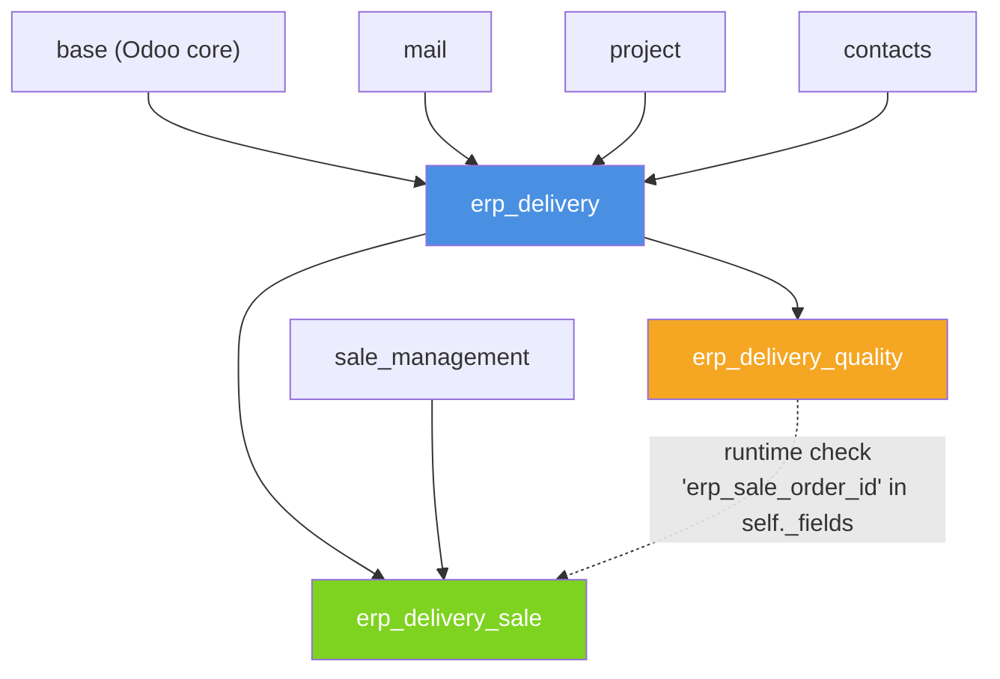

# ERP Delivery — Odoo 18 Backend

Quản lý vòng đời triển khai dự án ERP: khách hàng, danh mục giải pháp, dự án
triển khai, tích hợp Sales, và Quality Gate. Xem chi tiết đầy đủ trong
[`ERP_Delivery_Execution_Plan.md`](ERP_Delivery_Execution_Plan.md) và giải
trình kỹ thuật trong [`TECHNICAL_NOTES.md`](TECHNICAL_NOTES.md).

> Trạng thái: **Sprint 5/5 hoàn thành — dự án hoàn tất.** Xem [`docs/IMPLEMENTATION_STATUS.md`](docs/IMPLEMENTATION_STATUS.md).

## Kiến trúc: 3 addons độc lập cài đặt



| Addon | Vai trò | Bắt buộc? | Depend chính | Trạng thái |
|---|---|---|---|---|
| `erp_delivery` | **CORE**: Customer, Solution catalog, Project, Module lines, Task, Milestone, Risk, Security groups, Go-live base workflow | Bắt buộc | `base`, `mail`, `project`, `contacts` | **DONE** (Sprint 1–5) |
| `erp_delivery_sale` | Sales Integration: tạo Project từ Sale Order | Tùy chọn | `erp_delivery`, `sale_management` | **DONE** (Sprint 4) |
| `erp_delivery_quality` | Quality Gate: chặn Go-live nếu chưa đạt ngưỡng chất lượng | Tùy chọn | `erp_delivery` (không depend sale) | **DONE** (Sprint 5) |

- Đường nét liền = dependency cứng (manifest). Đường nét đứt = runtime soft-dependency.
  `erp_delivery_quality` kiểm tra `"erp_sale_order_id" in self._fields`
  (không phải `'sale.order' in self.env` như sketch gốc của đề — xem
  `TECHNICAL_NOTES.md` mục 3) để biết `erp_delivery_sale` có cài hay
  không, cho phép Quality Gate hoạt động độc lập khi Sales không cài.
- Đã verify thật: cả 3 addon cài được theo 4 tổ hợp (core / core+sale /
  core+quality / cả 3), và đổi thứ tự cài (sale trước quality hay ngược
  lại) cho cùng kết quả — xem `docs/implementation/
  005_quality_gate_performance_docs.md` mục 10.

## Cấu trúc thư mục

```
erp-delivery/
├── ERP_Delivery_Execution_Plan.md
├── TECHNICAL_NOTES.md            # 12 câu hỏi giải trình, cooperative inheritance, bridge case, performance
├── README.md                     (file này)
├── custom_addons/
│   ├── erp_delivery/              # CORE — README.md riêng
│   ├── erp_delivery_sale/         # README.md riêng
│   └── erp_delivery_quality/      # README.md riêng
└── docs/
    ├── IMPLEMENTATION_STATUS.md
    └── implementation/
        ├── 001_customer_and_solution_catalog.md
        ├── 002_project_core_workflow.md
        ├── 003_module_lines_tasks_milestones_risks.md
        ├── 004_go_live_base_and_sales_integration.md
        └── 005_quality_gate_performance_docs.md
```

## Chạy local (dev)

```bash
ODOO=/home/pc/odoo-dev/odoo
VENV=/home/pc/odoo-dev/odoo-venv/bin/python3
$VENV $ODOO/odoo-bin \
  --addons-path="$ODOO/addons,$ODOO/odoo/addons,/home/pc/odoo-dev/erp-delivery/custom_addons" \
  -d erp_delivery_dev \
  --db_host=/var/run/postgresql --db_port=5433 --db_user=pc \
  -i erp_delivery,erp_delivery_sale,erp_delivery_quality
```

Chạy toàn bộ test (3 addon):

```bash
$VENV $ODOO/odoo-bin \
  --addons-path="$ODOO/addons,$ODOO/odoo/addons,/home/pc/odoo-dev/erp-delivery/custom_addons" \
  -d erp_delivery_test \
  --db_host=/var/run/postgresql --db_port=5433 --db_user=pc \
  -i erp_delivery,erp_delivery_sale,erp_delivery_quality \
  --test-enable --test-tags /erp_delivery,/erp_delivery_sale,/erp_delivery_quality --stop-after-init
```

Mỗi addon cũng có thể cài/test độc lập — xem `README.md` riêng trong từng
thư mục `custom_addons/<addon>/`.
